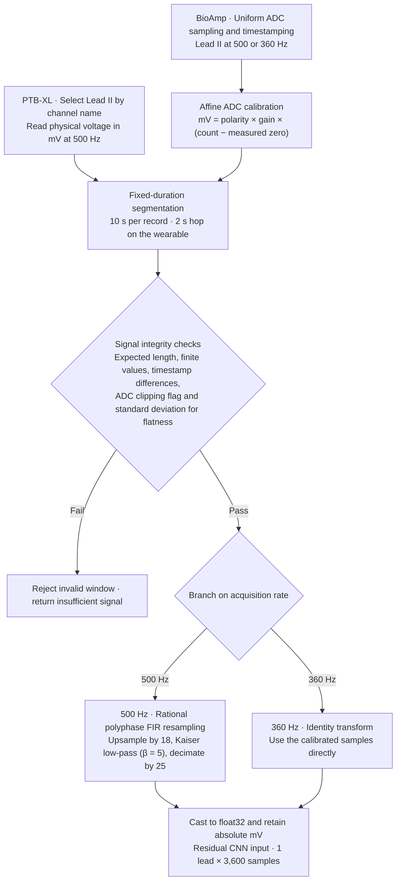
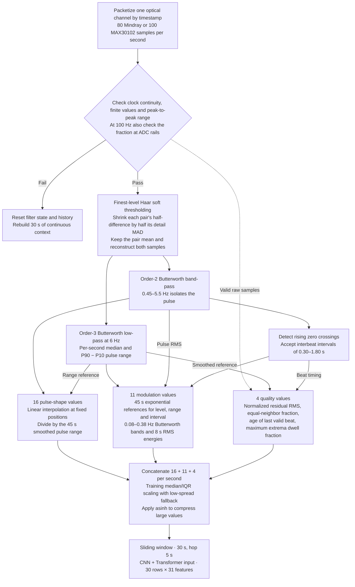
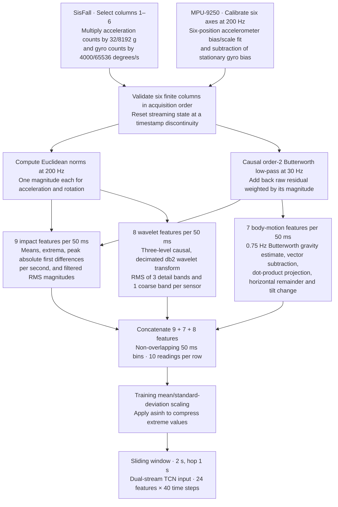
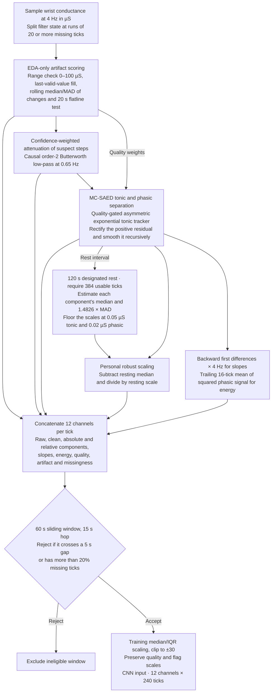

# Wearable health monitoring architecture

The system answers four different questions from four independently timed signals. This guide follows one trained deep model per dataset, restricted to inputs available on the intended wearable. “Best” refers to the selection evidence within each study. The ECG and PPG choices follow their saved validation rules, the IMU choice follows the repeated-seed development study, and the EDA choice ranks the wrist-EDA-only neural runs by mean inner-validation macro F1.

| Dataset and wearable input | Selected model | What one prediction means | Result on held-out people |
| --- | --- | --- | --- |
| PTB-XL · BioAmp single Lead-II approximation | Multiscale residual 1D CNN (`prep_minimal`) | One 10 s ECG contains a pattern associated with an LVH statement | Patient AP **0.437**. At the wearable record threshold, **105/214** positive ECGs detected |
| OSASUD · one optical channel from MAX30102 | Multiscale CNN + Transformer (`cnn_transformer`) | Five separate second-level estimates of apnea or hypopnea from the last 30 s | Mean patient AP **0.238**. Matched **52.2%** of reference events at **68.8 false events/h** |
| SisFall · waist MPU-9250 accelerometer and gyroscope | Teacher-assisted dual-stream multiscale TCN (`dm_distilled`) | The strongest 2 s window supplies the evidence for a whole fall trial | Mean subject-balanced accuracy **98.61%** across three seeds. **2.21–3.10 false alerts/h** during scripted daily activities |
| WESAD · wrist EDA alone | Rest-calibrated 1D CNN (`cnn_rest`) | A completed 60 s window resembles the laboratory stress condition | Mean participant macro F1 **0.829**, stress sensitivity **82.3%**, baseline specificity **88.2%** |

**How to read the numbers.** Average precision (AP) summarizes precision as the detection threshold varies. Its reference level depends on how common positives are. Sensitivity is the fraction of positives detected. Specificity is the fraction of negatives correctly rejected. F1 balances precision and recall at a particular decision rule. Macro F1 weights the classes equally. Each row uses its own unit of evaluation. For example, missing one long breathing event can produce many incorrect seconds but only one missed interval.

**Reading the diagrams.** Parallel branches compute different views of the same samples. MAD is the median absolute deviation, a robust measure of spread. IQR is the interquartile range. RMS is the root mean square, which measures signal strength. Each novelty section describes the project's design choice and the evidence for it on that dataset. A claim of first publication would require a separate prior-art review.

## PTB-XL · LVH-associated ECG patterns

**What the model sees.** The BioAmp measures a voltage difference. The model learns which voltage shapes and amplitudes across ten seconds of one lead predict the LVH diagnostic statement used in PTB-XL. The reference is a clinician-interpreted ECG statement. Anatomical confirmation by echocardiography falls outside this experiment.

### Preprocessing flow

A 10 s recording at 500 Hz starts with 5,000 measurements and ends with 3,600. The duration and the millivolt scale stay the same. On the wearable, the next window starts 2 s later.

1. **Construct the learning target.** Read the calibrated 500 Hz PTB-XL waveform and select Lead II from the twelve recorded leads. An ECG with the LVH statement is positive. Other eligible ECGs, including those with other abnormalities, are negative. Excluding a contradictory LVH/NORM record leaves 21,798 ECGs. Keep patient identity for grouping and official folds for splitting.
2. **Preserve measured voltage and timing.** Express the lead in millivolts. Resample each complete 10 s recording from 500 to 360 Hz with a polyphase anti-aliasing FIR filter (Kaiser window, β = 5). A calibrated native 360 Hz input already has the required 3,600 samples. The selected minimal pipeline retains absolute amplitude. Per-record standardization would erase voltage differences the detector can use.
3. **Recognize waveform shapes.** A 1D convolution groups 18 samples (50 ms) into each of 200 time positions with 32 learned features. Two residual blocks apply parallel kernels of 3 and 7 positions with dilations 1 and 2 respectively. Short kernels describe local shapes while longer, spaced kernels combine them over more of a heartbeat. Each block concatenates its two paths, mixes them and adds its input back. Temporal mean and maximum pooling retain sustained patterns and strong local responses. The resulting 64 values feed a 48-unit layer and one raw score, called a logit.
4. **Fit, select and calibrate.** Train on official folds 1–6 for seven epochs using positive-weighted binary cross-entropy and AdamW (learning rate and weight decay both 0.001). Rank on folds 7 and 8 by mean patient AP, with prespecified tie-breaks. Refit the chosen configuration on folds 1–8. Fold 9 fits the probability mapping and thresholds targeting 90% specificity. Fold 10 evaluates those fixed choices. For the patient endpoint, take the highest logit across that patient's ECGs and mark the patient positive if any eligible ECG is positive.
5. **Apply one wearable decision.** Position LL positive relative to RA and use the third electrode as reference. Digitize the analog BioAmp output and convert counts using measured zero offset, input-referred millivolts per count and verified polarity. Buffer 10 s and advance by 2 s. Clock gaps, missing samples, flat signal or detected clipping withhold the score. For an accepted window, the export applies `p = sigmoid(0.89933 × logit − 2.24084)` and flags `p ≥ 0.18572`. The sigmoid maps the score to the interval from zero to one.

**Results and limits.** Among 1,904 fold-10 patients, 202 were positive. Patient AP was 0.437, AUROC 0.804 and F1 0.429. The patient-specific operating threshold of 0.18841 detected 104/202 patients (51.5%) at 89.5% specificity. At the separate wearable threshold, record AP was 0.404, sensitivity 49.1% and specificity 89.6% across 2,198 ECGs. These numbers describe retrospective Lead II. The same official test fold featured in earlier project work. Performance on newly acquired BioAmp signals remains unmeasured. [Study and held-out curves](../research/results/lvh_distill_v1/REPORT.md) · [Wearable confusion counts](../research/results/lvh_distill_v1/wearable_window_metrics.json)

### PTB-XL novelty — preserving physical voltage through single-lead inference

**What the project contributes.** The same 10 s Lead II voltage representation connects the dataset, the residual CNN and the BioAmp replay path. Keeping the signal in calibrated millivolts lets the CNN use absolute amplitude as well as shape. Separate probability calibrations handle the recording-level and patient-level endpoints. One asks whether the current ECG contains an LVH-associated pattern. The other asks whether any recording from a patient does. The contribution is this voltage-preserving, testable acquisition-to-score method. Its resampler and residual convolutions are established algorithms. [Waveform implementation](../modules/ecg/src/wearable_ecg/preprocessing/pipeline.py) · [Wearable inference](../modules/ecg/experiments/lvh_distillation/wearable.py)

**What the experiment supports.** The minimal pipeline gained 0.008 patient AP over the reproduced single-lead baseline (paired 95% interval −0.016 to +0.034). The proposed confidence-aware teaching experiment changed AP by −0.010 when added to a matched joint model (−0.027 to +0.010). Neither result establishes an accuracy gain. Replaying 59 archived ECGs through the exported raw-input path reproduced reference logits to within 0.000001. The selected model performs single-lead inference without teacher supervision. [Paired comparisons](../research/results/lvh_distill_v1/paired_kd.csv) · [Network](../modules/ecg/experiments/lvh_distillation/network.py) · [Export verification](../research/results/lvh_distill_v1/export.json)

## OSASUD · respiratory events from optical pulse

**What the model sees.** A pulse waveform contains both individual pulses and slower changes in their level, size and spacing. The model combines these to estimate whether a clinician marked apnea or hypopnea at a given second. A pulse sensor measures blood-volume changes, so the evidence for an airway event is indirect.

### Preprocessing flow

One usable Mindray second starts with 80 optical samples. The three views describe that same second from different angles, so they join side by side into one row. After 30 rows, the model scores the final five seconds individually.

1. **Reconstruct each patient's timeline.** Read the Mindray 80 Hz plethysmogram in timestamp order, 80 samples per second. Align each second to NONE, HYPOPNEA, APNEA-CENTRAL, APNEA-OBSTRUCTIVE or APNEA-MIXED. The four event labels are positive for the primary binary task. Validate clock continuity and packet length. Reset state across unusable packets and withhold scores until context has rebuilt. Of 961,357 labeled seconds from 30 stroke-unit patients, 130,309 contained nonfinite samples and another 580 were flat. After warm-up and incomplete blocks, 821,545 seconds (228.21 h) were scored.
2. **Retain the pulse shape.** For each adjacent pair of samples, keep their mean and shrink the finest Haar detail using a robust within-second noise estimate. Reconstruct the pair. This reduces rapid variation while preserving the local mean. Band-pass at 0.45–5.5 Hz and take 16 evenly spaced pulse-shape values per second, scaled by a slowly tracked pulse range.
3. **Retain slower changes and describe quality.** From a separate 6 Hz low-pass trace compute median level and robust pulse range (90th minus 10th percentile). Use trailing 45 s exponential references for baseline, amplitude and beat-interval changes. Estimate the beat interval from accepted upward crossings. Filter the three changes at 0.08–0.38 Hz and track their energy over an 8 s exponential timescale. Pulse RMS and beat interval complete 11 modulation values. Four quality values describe high-frequency residual, repeated samples, time since a reliable beat and dwell at an observed extreme. These help distinguish an optical plateau from a physiological change.
4. **Build and encode the context.** Each second now has 31 values (16 shape + 11 modulation + 4 quality). Apply training-patient medians and interquartile ranges, then inverse-hyperbolic-sine compression to limit the influence of extreme values. Group 30 consecutive seconds and advance by 5 s. Project each view to width 32, join the views and apply a residual temporal convolution. Parallel 3 s and 7 s convolutions capture local changes. Positional encoding and one four-head Transformer layer relate those changes across the completed 30 s context. A shared head reads the last five positions separately. This preserves event boundaries that a single label for the whole window would blur.
5. **Train and turn seconds into events.** Each of five patient-independent folds used 18 people for learning, six for validation and six for testing. Sampling mixes 400 uniform and 240 event-enriched contexts per training patient per epoch. The network learns a binary event score on every target second and a conditional four-way subtype on positive seconds. Validation selects epochs by mean patient AP and sets the operating threshold by mean patient event F1. Both the original comparison and the later two-time-scale study retain this CNN + Transformer as the overall validation choice. The all-patient research export uses two training epochs, out-of-fold calibration and a probability threshold of 0.14836. Five consecutive positive seconds confirm a candidate interval. Each five-second block arrives 0–4 s after its individual target seconds end.

**Results and limits.** Mean patient AP was 0.238 (95% patient-bootstrap interval 0.170–0.306), against a constant-score reference of 0.160. A predicted interval matched one reference interval when intersection divided by union was at least 0.30. The model matched 3,125 of 5,985 scored reference intervals. Event precision was 0.166, recall 0.522 and F1 0.252, with 68.8 false intervals/hour. At a validation target of one false interval/hour, held-out recall fell to 0.40% at 1.15 false intervals/hour. Five-class macro F1 was 0.193. The evidence supports research replay. Caregiver alerts and subtype reporting would require substantially better discrimination. [Event counts, thresholds and curves](../research/results/osasud_v1/REPORT.md) · [Overall selection after the follow-up](../research/results/osasud_binary_dual_rate_v1/selection.json)

### OSASUD novelty — preserving breathing-related changes while labeling individual seconds

**What the project contributes.** One optical stream supplies three synchronized descriptions of each second covering pulse shape, slower changes in pulse size and spacing, and signal quality. Pair-mean-preserving denoising and a trailing amplitude reference keep slow variation available even after the separate pulse-shape path is band-pass filtered. The CNN + Transformer reads 30 s for context and predicts five individual seconds. A window that straddles an event boundary can therefore contain both negative and positive targets. This pairing of complementary inputs with boundary-preserving supervision is the proposed contribution. [Feature definitions](../modules/ppg/src/wearable_ppg/preprocessing/optical.py) · [Network](../modules/ppg/src/wearable_ppg/models/respiratory.py)

**What the experiment supports.** In a matched control network on the same 30 patients, restoring modulation and quality to a pulse-shape-only input raised mean patient AP by 0.041 (paired 95% interval +0.023 to +0.060). Restoring pulse shape and quality to modulation alone gave +0.006 (−0.002 to +0.014). The clearest evidence favors keeping slow modulation. The comparisons leave the individual contributions of Haar shrinkage, attention and boundary supervision unresolved. [Paired input ablations](../research/results/osasud_v1/paired_ap.csv)

**Wearable transfer.** The MAX30102 path accepts one channel at 100 Hz with verified polarity. Physical-device accuracy and any gain from using both red and infrared channels require paired recordings. [Sensor validation](../modules/ppg/docs/hardware_validation.md)

## SisFall · falls from a waist-mounted IMU

**What the model sees.** Acceleration describes impact and changes in body motion. Angular velocity describes rotation. A short burst in either can also occur during ordinary activity. The network estimates which combinations of both signals make a recording resemble a simulated fall.

### Preprocessing flow

A short impact can fall between two 50 ms summary boundaries. Taking peaks and maximum changes at the original 200 Hz before forming each row preserves evidence that averaging the ten readings could hide.

1. **Audit the six-axis trials.** Keep subject, activity and trial identifiers. Read the first three ADXL345 axes as counts × 32/8192 g and the next three ITG3200 axes as counts × 4000/65536 degrees/s at 200 Hz. Exclude the second accelerometer. Five conflicting subject/filename assignments were excluded, leaving 2,702 daily-activity trials and 1,798 simulated falls from 38 people. Flag repeated readings and rail values while retaining impact peaks. The source sample index provides no independent clock for detecting unmarked packet loss.
2. **Preserve impacts while estimating body motion.** IPMV (Impact-Preserving Multi-View preprocessing) keeps native-rate magnitudes on a direct path. For each 50 ms token, preserve short extrema and the largest absolute one-sample magnitude change. A parallel causal second-order, 30 Hz adaptive filter passes more raw residual during large changes. A 0.75 Hz filter estimates the gravity vector. Subtract it to estimate dynamic acceleration and project motion and rotation parallel and perpendicular to gravity. These measures survive a common fixed rotation of the axes. Rapid body rotation can still make the gravity estimate lag.
3. **Represent several timescales.** Apply a three-level causal Daubechies-2 wavelet decomposition to acceleration and gyro magnitudes. Summarize each detail band and the remaining coarse band by RMS per token. Combine these with impact and gravity-relative measures to form 24 values every 50 ms. Standardize by training-subject means and standard deviations and apply inverse-hyperbolic-sine compression. Feed 40 tokens (2 s) at a time with a 1 s hop. Windows have equal length and no padding. A duration-only control classified every trial correctly, showing why full file length would be a misleading input.
4. **Learn from trial labels without inventing an impact time.** Treat each recording as a bag of windows. During training, sample eight positions and apply the trial loss to the maximum window logit. A training-only XGBoost teacher starts with high-acceleration candidate windows, then refines its candidates using trial labels. Its softened window scores (temperature 2) guide the neural network alongside the trial loss. At evaluation, scan all complete windows and use the strongest evidence for the trial. Attention weights and high-scoring windows identify model evidence, with no reference annotation for the exact impact instant.
5. **Fuse sensors and score.** The acceleration and gyro branches each project to 12 channels. Parallel kernels of 3, 5 and 9 tokens describe local patterns. Residual temporal convolutional network (TCN) blocks use dilations 1, 2 and 4 to look further back. A learned sigmoid gate weights the two sensor representations at each time and feature. Attention weights summarize the completed window and a linear head emits one logit. The 5,846-parameter network runs on its own at inference. The exported policy thresholds the raw logit at 0.74120, reports calibrated evidence separately, waits 5 s after an alert and requires two below-threshold windows to re-arm.

**Results and limits.** In five subject-grouped folds, three groups trained the inner model, one chose settings and one was held out. Each outer refit used all four development groups. The report selected this follow-up neural candidate for its repeatability. Across three seeds on the same people, subject-balanced accuracy was 98.20%, 98.58% and 99.04%. This metric gives equal weight to average participant fall sensitivity and daily-activity specificity. Scripted daily activities still produced 2.21, 2.34 and 3.10 false alerts/hour. Only one of the 15 older participants performed simulated falls. These results establish trial classification on SisFall. Real-home fall sensitivity, onset delay and alarm burden remain open. [Report and duration control](../research/results/sisfall_v1/REPORT.md) · [Per-seed counts and rates](../research/results/sisfall_v1/replicate_seeds.csv)

### SisFall novelty — keeping impact evidence and learning where to look from trial labels

**What the project contributes.** IPMV carries native-rate impact peaks past the smoothing stage while a parallel path describes gravity-relative motion and another measures energy at several timescales. The dual-stream TCN learns how much weight to give acceleration and rotation. During training, a weakly supervised teacher supplies candidate window scores and a maximum-over-windows loss connects those windows to the known trial label. This lets the pipeline learn from short bursts inside long trials without treating every window as a labeled fall. The proposed contribution is how impact preservation, orientation robustness and trial-level learning work together. [IPMV implementation](../modules/imu/src/wearable_imu/preprocessing/ipmv.py) · [Training protocol](../research/sisfall_protocol.md)

**What the experiment supports.** On the same participant splits, the teacher raised the weakest of three training runs from 82.62% to 98.58% subject-balanced accuracy. The other paired changes were −0.84 and approximately 0 percentage points. The observed benefit was improved repeatability across these seeds. A shared fixed-axis rotation changed zero distilled-model decisions in replay. These checks cover initialization and static rotation. They leave performance under a loose or moving belt, true fall onset and real-home use open. [Seed comparisons](../research/results/sisfall_v1/distillation_paired.csv) · [Transfer tests](../research/results/sisfall_v1/transfer_distilled.csv)

**Wearable transfer.** The waist MPU-9250 requires its own calibration, axis mapping, bandwidth and clipping checks. The 69,632-byte FP32 export took 1.06 ms at the 95th percentile for a full hop on the workstation. Jetson timing and physical transfer remain to be measured. [Export verification](../research/results/sisfall_v1/export_dm_distilled.json) · [Hardware calibration and replay](../modules/imu/docs/hardware_validation.md)

## WESAD · stress-associated wrist EDA

**What the model sees.** Skin conductance has a slowly varying level (tonic) and shorter responses (phasic). This model compares both with the wearer's own resting conductance, then estimates whether a minute of wrist EDA resembles WESAD's baseline or stress condition. It requires one wrist EDA sensor and a designated 120 s resting capture. The waist IMU serves the fall model independently.

### Preprocessing flow

The resting capture supplies a personal reference for later windows. For example, a slow rise can reach the CNN both as an absolute conductance level and as a rise above that wearer’s usual level. The reserved resting interval is excluded from scoring.

1. **Define comparable windows.** Use Empatica E4 wrist EDA at 4 Hz in microsiemens (µS). Align the synchronized 700 Hz protocol labels to 60 s EDA windows, advancing 15 s. Keep windows with at least 80% of their labels in the target state (1 baseline or 2 stress). Exclude other states and reserve the resting interval from scoring. Across 15 participants aged 24–35, 1,008 baseline and 628 stress windows qualified.
2. **Assess contact and clean continuously.** Flag nonfinite or out-of-range values (research plausibility range 0–100 µS). Use the last valid value for short invalid stretches. Compare changes with a trailing 30 s median and median absolute deviation (MAD). Step reversals, sustained flatness and near-zero conductance indicate possible artifacts. Attenuate suspect changes and apply a causal two-pole 0.65 Hz low-pass. Preserve raw conductance as a separate input. A gap of 5 s resets filter state and excludes intersecting windows. Exclude windows with over 20% missing observations. All quality estimates for this configuration come from EDA.
3. **Separate slow level from rapid responses.** In the project's MC-SAED decomposition, a quality-weighted tonic tracker follows downward relaxation faster than upward excursions. This leaves room for positive pulses above baseline. Smooth the positive remainder to form the phasic estimate. During the designated rest, require at least 384 usable quarter-second samples. For each component, subtract its resting median and divide by 1.4826 × resting MAD, with scale floors of 0.05 µS for tonic and 0.02 µS for phasic. Keep both absolute and rest-relative channels. The resting reference is the only personalized measurement required.
4. **Pass 12 signals to a compact CNN.** Each window has 240 samples of raw, cleaned, tonic, phasic, relative tonic, relative phasic, tonic slope, phasic slope, phasic energy, quality, artifact and missingness. Fit numeric medians and interquartile ranges on training subjects. Keep quality indicators on their original scales. A convolution with width and stride 4 embeds each second into 16 features. Two temporal convolutions with kernels of 5 and 3 seconds and GELU activations learn patterns across adjacent seconds. Average the 60 output positions, then apply layer normalization, dropout during training and a two-class linear head. The model has 2,930 trainable parameters.
5. **Test on a new person.** Leave one participant out at a time. Within each fold, 12 train the model and two select the epoch by mean subject macro F1 and fit a scalar temperature for the class scores. Use class-weighted cross-entropy, AdamW at 0.002 and up to six epochs. Refit on the 14 development participants for the selected epoch count, then apply temperature-scaled class probabilities to the held-out participant's windows. The test person's designated rest supplies their baseline. Their scored windows do not fit network weights, scalers or temperature.

**Results and limits.** Filtering the study to primary binary neural configurations with EDA as the sole modality, `cnn_rest` ranked first on mean inner-validation macro F1 (0.869). Its mean held-out participant macro F1 was 0.829 (95% participant interval 0.734–0.918), accuracy 85.9%, stress sensitivity 82.3%, baseline specificity 88.2% and AUROC 0.962. A control using only elapsed session time reached 0.999 macro F1. Although the CNN receives no clock feature, physiological changes correlated with the laboratory schedule can also predict the label. These results describe protocol-associated arousal in young adults. Daily-life stress in older adults is a separate validation question. [Model results, row neural/cnn_rest](../research/results/wesad_loso_v1/all_models.csv) · [Protocol timing control](../research/results/wesad_loso_v1/clock_control.csv)

### WESAD novelty — tracking wrist conductance quality and each wearer's resting level

**What the project contributes.** The wrist-only MC-SAED path uses signal quality twice. Suspect steps receive less weight during cleaning and slow-level tracking, and their quality scores remain visible to the CNN. The asymmetric tracker follows downward relaxation faster than upward excursions, leaving rapid positive responses in the phasic channel. Both components reach the CNN in absolute units and relative to the wearer's designated rest. This is a signal representation and calibration contribution. The classifier itself is a conventional 1D CNN, and the signal path uses wrist EDA alone. [Decomposition implementation](../modules/eda/src/wearable_eda/preprocessing/wrist.py) · [CNN implementation](../modules/eda/src/wearable_eda/models/wrist.py)

**What the experiment supports.** On the same 1,636 scored windows from 15 held-out participants across folds, the same EDA-only CNN averaged 0.829 participant macro F1 with the rest reference and 0.735 under zero calibration (observed difference +0.095 using unrounded scores). This comparison supports personal calibration on WESAD. It does not isolate the gain from the decomposition or prove that the extracted components match physiological ground truth. The laboratory schedule remains a strong confound for a stress claim. [Matched configurations, rows `neural/cnn_rest` and `neural/cnn_zero`](../research/results/wesad_loso_v1/all_models.csv) · [Decomposition evidence](../modules/eda/docs/preprocessing.md)

**Wearable transfer.** Establish the planned GSR module's conversion to µS, electrode contact behavior and resting reference before interpreting its scores. This EDA-only configuration has subject-fold checkpoints. The existing full-cohort neural exports use different sensor inputs. [Training and checkpoint layout](../modules/eda/docs/neural.md)

## From research replay to the wearable

**Offline flow.** Each signal module owns its dataset reader, labels, participant splits, preprocessing, network, training and evaluation. Dataset files stay in local read-only source locations. Keep all windows from the same person in their assigned split. Fit learned preprocessing on training people and use development predictions for thresholds and calibration. Evaluate on the held-out people before fitting an export for future recordings.

**Live flow.** The intended path is sensor → timestamped acquisition → per-signal quality checks and buffers → the corresponding model and its saved transforms → timestamped prediction → backend/API → frontend. Each stream follows its own clock and update rate. Preserve the signal identity, observation interval, model version and quality status with each score. A missing stream produces an unavailable result. This repository supports independent research predictors and replay. Combined health scoring, clinical escalation and end-to-end field performance would require their own implementation and validation.

| Repository area | Responsibility |
| --- | --- |
| `acquisition/`, `edge/` | Device drivers, transport, clocks and replay, followed by predictor adapters, scheduling and health |
| `modules/{ecg,ppg,imu,eda}/` | Signal-specific offline and inference code, tests and model configurations |
| `packages/common/`, `contracts/` | Shared interfaces and versioned message schemas |
| `apps/backend/`, `apps/frontend/` | API and persistence, then presentation of predictions and quality |
| `research/results/`, `artifacts/`, `deploy/` | Reviewable metrics and figures, local trained weights and runtime metadata, and deployment packaging |

**How to verify a result.** For ECG, check the record confusion counts or the separate patient table. For PPG, use the interval counts and scored hours to reproduce recall and false events/hour. For IMU, filter the seed table to `dm_distilled` and average its three `subject_ba` entries. For EDA, filter the results CSV to `neural/cnn_rest` and use its subject-averaged `macro_f1`. The corresponding local model locations are `artifacts/ecg/exports/lvh_distill_v1/prep_minimal/`, `artifacts/ppg/exports/osasud_v1/cnn_transformer/`, `artifacts/imu/exports/sisfall_v1/dm_distilled/` and `artifacts/eda/runs/wesad_loso_v1/neural/cnn_rest/Sxx/model.pt` (replace Sxx with the held-out subject, for example S02). Team members can inspect the linked results without copying participant data or model weights. [Deployment guide](deployment.md) · [Validation guide](validation.md)
