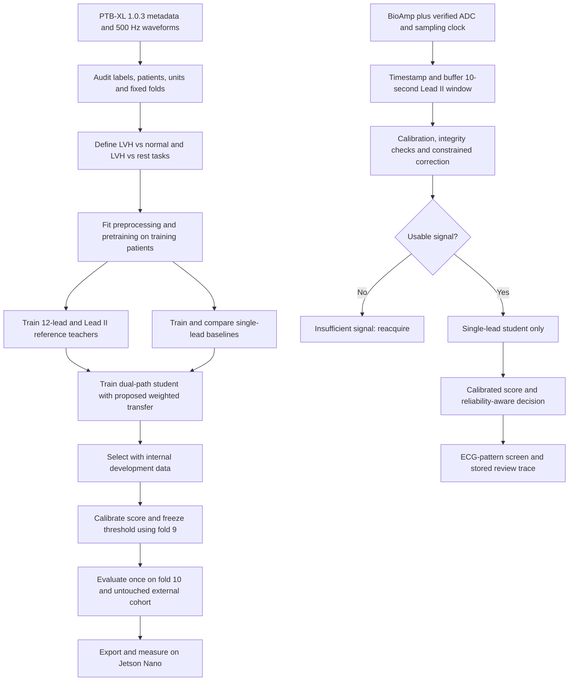

# Research review and proposed protocol: single-lead ECG patterns associated with LVH

Prepared 5 November 2026. Based on the supplied R&D brief, a focused search of PTB-XL-using/citing research, primary papers and official hardware documentation, and a fresh audit of the public PTB-XL 1.0.3 metadata.

## Progress as of 6 November 2026

The team completed 30 supervised training runs on PTB-XL 1.0.3 using 10-second Lead II windows resampled from 500 to 360 Hz. Each architecture ran with five seeds on each of two cohorts. The strict-normal comparison included 9,383 recordings. The broader comparison included 21,798 recordings and treated other abnormal ECGs as eligible controls. Both cohorts contained 2,131 recordings with an LVH diagnostic statement.

**Held-out results.** Values are means across five individual models per architecture. Development used official patient folds 1–6 for fitting and 7–8 for epoch selection. Each run then refitted on folds 1–8 and used fold 9 to calibrate probabilities and set a threshold targeting 90% specificity. The table gives the observed results on fold 10. Average precision summarizes the precision–recall curve.

| Comparison | Model | AUROC | Average precision | Sensitivity | Specificity |
|---|---|---:|---:|---:|---:|
| LVH vs strict normal | CNN | 0.933 | 0.884 | 82.2% | 90.8% |
| LVH vs strict normal | CNN + diagonal state-space model | 0.900 | 0.837 | 76.3% | 90.5% |
| LVH vs strict normal | CNN + Transformer | 0.910 | 0.851 | 77.1% | 91.2% |
| LVH vs all other ECGs | CNN | 0.811 | 0.402 | 52.0% | 89.2% |
| LVH vs all other ECGs | CNN + diagonal state-space model | 0.792 | 0.378 | 47.5% | 89.5% |
| LVH vs all other ECGs | CNN + Transformer | 0.787 | 0.378 | 47.7% | 89.5% |

The CNN achieved the highest mean test AUROC on both tasks. Including other cardiac abnormalities reduced its sensitivity from 82.2% to 52.0% at the frozen operating thresholds. The prespecified development criterion selected the CNN for strict normal and the CNN + Transformer for the broader task. The held-out results above describe how those choices generalized. [Development selection](results/20261105_lvh_comparison/development_selection.csv) · [Per-seed metrics](results/20261105_lvh_comparison/comparison_per_seed.csv)

**Preprocessing and novelty.** The fitted controller selected minimal correction for every cached recording. The architecture comparison therefore measures performance on minimally corrected, calibrated Lead II signals. The proposed denoising benefit remains unproven. The development experiment records waveform and morphology errors under synthetic noise. [Preprocessing fidelity graph](results/20261105_lvh_comparison/preprocessing/preprocessing_fidelity.png)

**Verification and outputs.** Recomputing AUROC, average precision and confusion counts from fold-10 predictions reproduced the saved metrics for all 30 runs. All 12 regression checks and all six ONNX export comparisons passed. Runtime preprocessing reproduced the cached waveform and all 16 features exactly on 128 original training records. After training, all 43,601 source-file hashes matched. The full report includes patient-bootstrap intervals, age-65+ results and operating thresholds. [Full report](results/20261105_lvh_comparison/RESULTS.md) · [Age subgroup graph](results/20261105_lvh_comparison/plots/lvh_vs_rest/age_subgroups.png) · [Input parity](results/20261105_lvh_comparison/inference_input_parity.json) · [Source integrity](results/20261105_lvh_comparison/source_integrity_after.json)

**Open work.** The research hypothesis still requires classifier-level preprocessing ablations and a controlled comparison of ordinary and reliability-weighted cross-lead distillation. External validation, BioAmp recordings and physical Jetson Nano timing remain pending. The current endpoint is the PTB-XL ECG annotation. Anatomical LVH validation requires paired imaging evidence.

## Original research plan and literature review

**Recommendation.** Develop a compact, dual-path convolutional Transformer that retains a separate calibrated voltage representation. Train it with a 12-lead teacher using a proposed reliability-weighted distillation objective. Couple it to a proposed preprocessing method whose noise reduction is constrained by measured voltage, QRS and ST/T fidelity. Evaluate Mamba as a matched alternative, not as an assumed improvement. The scientific contribution should be preservation and transfer of usable single-lead evidence under acquisition noise, rather than merely a new combination of named neural-network blocks.

The original specification below predates the supervised runs summarized above. The review is targeted, not an exhaustive systematic review of every PTB-XL citation. Numerical results below belong to their respective papers and are not forecasts for this project. A literature search cannot certify worldwide novelty; the proposed contributions require a closer prior-art comparison and experiments before making a first-of-its-kind claim.

**What the relevant papers establish.** Full methods/results were inspected where accessible; access limitations are identified in the table. Preprints are distinguished from published papers. PTB-XL tasks, lead counts, sampling rates and evaluation splits vary substantially, so these results are not a single leaderboard.

| Study and evidence inspected | Method and relevant finding | Consequence for this project |
|---|---|---|
| [Strodthoff et al., Deep Learning for ECG Analysis, 2020/2021](https://arxiv.org/pdf/2004.13701), full preprint and published abstract | Broad PTB-XL benchmarking finds strong ResNet/Inception CNN performance and examines uncertainty and hidden stratification. | A well-tuned CNN is mandatory. A new architecture must beat it under identical leads, cohorts, splits and preprocessing. |
| [Taconné, Corino and Mainardi, An ECG-Based Model for LVH Detection, online 2024 / volume 2025](https://pmc.ncbi.nlm.nih.gov/articles/PMC11655100/), indexed article sections and author abstract; direct full-page access intermittent | ECG feature extraction with RF/SVM; PTB-XL development and Georgia external evaluation. Uses voltage and morphology from multiple leads. | Direct LVH prior art. Include a single-lead feature model, and reserve a separate external dataset. Its 12-lead results do not establish Lead II performance. |
| [Strodthoff et al., PTB-XL+, 2023](https://pmc.ncbi.nlm.nih.gov/articles/PMC10183020/), full article | Adds features from different ECG analysis systems and compares their agreement and prediction performance. | Useful for feature baselines and auxiliary targets. Automated measurements are not error-free ground truth; do not feed diagnostic interpretation outputs back into the classifier. |
| [MVKT-ECG, 2023 preprint](https://arxiv.org/html/2301.12178v1), full preprint; later journal version identified | Uses contrastive representation transfer and multi-label distillation from multiple leads to a single lead. It explicitly discusses information lost through lead reduction. | Neither cross-lead distillation nor recognizing missing-lead information is novel. The proposed contribution must be a specific, tested improvement to how transfer is weighted. |
| [ST-MEM, ICLR 2024](https://arxiv.org/html/2402.09450v1), full preprint and conference appendix | Masked spatiotemporal ECG representation learning; reports Lead II AUROC 0.856 in its PTB-XL single-lead evaluation. | Supports single-lead pretraining. That value is not LVH-specific, and its evaluation protocol should not be silently substituted for the official folds. |
| [Medformer, NeurIPS 2024](https://arxiv.org/html/2405.19363v2), full paper including preprocessing appendix | Multi-granularity patching and attention. PTB-XL processing uses 1-second segments and a custom 60/20/20 subject split, after excluding subjects with inconsistent diagnoses. | Multi-scale attention is established. Reimplement useful ideas on the required official folds; its published scores are not directly comparable to this project's 10-second LVH task. |
| [ECGMamba, 2024 preprint](https://arxiv.org/html/2406.10098v1), full preprint | CNN encoding plus bidirectional state-space blocks; reports 0.9167 AUC, 5.31M parameters and 101.33M FLOPs for a 100-Hz, five-superclass PTB-XL task. | Mamba is a relevant comparator. These are neither LVH-only nor Jetson Nano measurements; linear sequence complexity does not prove faster deployment. |
| [Weimann and Conrad, JEPA ECG pretraining, 2025](https://www.sciencedirect.com/science/article/pii/S0010482525011606), published abstract plus [full preprint](https://arxiv.org/html/2410.13867v1) | Predicts latent representations of masked ECG regions; reports macro-AUC 0.945 on the PTB-XL all-statements task after large-scale pretraining. | Strong candidate for a teacher or pretraining comparator. Audit checkpoint provenance, test overlap and input normalization. A large pretrained model is not the default wearable runtime. |
| [Nandy et al., single-lead LVH pilot, 24 September 2026](https://pubmed.ncbi.nlm.nih.gov/42784719/), abstract only | Transformer with Lead I; AUC 0.874 ± 0.062 for ECG alone and 0.928 ± 0.017 with demographics. Reference is ECG-annotated LVH. | Closest direct overlap: single-lead Transformer LVH detection is already published. Lead I is different from Lead II. Full-text split, cohort and uncertainty details must be checked before a strict comparison. |
| [Su et al., Edge–Cloud ECG with Cross-Lead Distillation, June 2026](https://pmc.ncbi.nlm.nih.gov/articles/PMC13306982/), full article | InceptionTime–Transformer teacher and lightweight Lead II student; edge evaluation includes simulation. The reported 92.8% Macro-F1 and 94.7% AUC figures in the abstract are fractions of teacher performance retained. | Hybrid teacher plus Lead II edge student already exists. Do not misread retention percentages as absolute diagnostic scores or simulation as physical device validation. |
| [A Hybrid CNN–State-Space–Attention Backbone with JEPA, September 2026](https://arxiv.org/html/2609.29376v1), full preprint | Combines all three backbone families with JEPA. Uses single-label filtering for downstream tasks; PTB-XL gains depend on the metric. | CNN + Mamba/SSM + attention + JEPA is already prior art. Adding these components together is insufficient novelty and may not improve the metric that matters. |
| [MSCA-Mamba, 2026](https://pmc.ncbi.nlm.nih.gov/articles/PMC13664229/), full article | Multi-scale convolution, channel recalibration and Mamba; uses per-record z-scoring and reports mean superclass macro-AUC 0.8998 ± 0.0022. | Recent architecture does not automatically outperform older CNNs. Per-record amplitude normalization must be separately tested for this voltage-sensitive task. |
| [Shivakumar et al., Masked Generative Distillation for IoMT ECG, 30 October 2026](https://pubmed.ncbi.nlm.nih.gov/42967037/), abstract only | PTB-XL teacher/student study reports the main benefit under synthetic corruption rather than clean conditions; profiles deployment in simulation. | Even noise-robust cross-lead distillation is existing work. Compare ordinary KD and a strong noise-augmented KD baseline, not only an unaugmented student. |

**Preprocessing prior art also constrains novelty.** ST-preserving baseline correction has been studied explicitly: [Lenis et al.'s simulation comparison](https://pmc.ncbi.nlm.nih.gov/articles/PMC5361052/) evaluates morphology changes, and [combined morphological/wavelet filtering](https://pmc.ncbi.nlm.nih.gov/articles/PMC6421786/) addresses T-wave and filter-induced distortion. [A wavelet comparison](https://pmc.ncbi.nlm.nih.gov/articles/PMC7772919/) shows that family/decomposition choices depend on the data and artifact. [A fully gated denoising autoencoder](https://pubmed.ncbi.nlm.nih.gov/39943444/) already uses a multi-component objective for morphology preservation. Therefore, wavelets, adaptive denoising, morphology losses, and quality gates cannot individually be presented as new discoveries.

**The defensible research hypothesis.** A preprocessing and learning system that explicitly budgets voltage/morphology distortion, represents acquisition uncertainty, and reduces reliance on unreliable or unavailable-lead evidence can improve the robustness–sensitivity tradeoff for Lead II LVH-pattern classification. The proposed mechanisms below are candidates for contribution; the broad ingredients are established. A failed experiment remains informative and should trigger simplification rather than a claim of novelty by renaming components.

**Verified data audit and cohort definitions.** The downloaded metadata and reproducible audit are in this directory. These are metadata counts, before waveform-based exclusions. The source version corrects duplicates from older releases. Official documentation specifies that diagnostic confidence zero means unknown confidence, not absence, and that unusually large age values encode older patients. See [PTB-XL 1.0.3](https://physionet.org/content/ptb-xl/1.0.3/).

| Metadata-defined group | Recordings | Unique patients within group | Train folds 1–8 | Validation fold 9 | Test fold 10 |
|---|---:|---:|---:|---:|---:|
| All records | 21,799 | 18,869 | 17,418 | 2,183 | 2,198 |
| LVH code present, any recorded likelihood | 2,132 | 1,904 | 1,708 | 210 | 214 |
| LVH present, excluding NORM contradiction | 2,131 | 1,903 | 1,707 | 210 | 214 |
| LVH likelihood 100, excluding contradiction | 1,084 | 949 | 886 | 97 | 101 |
| LVH is the only diagnostic code | 456 | 444 | 354 | 54 | 48 |
| NORM is the only diagnostic code; form/rhythm codes allowed | 9,069 | 8,478 | 7,243 | 914 | 912 |
| Strict normal: all codes belong to {NORM, SR}, NORM present | 7,252 | 6,836 | 5,872 | 679 | 701 |
| No LVH code | 19,667 | 17,172 | 15,710 | 1,973 | 1,984 |

Patients can have several recordings and appear in more than one label group; patient counts in rows must not be added. The audit found zero patients spanning official folds. One record, ECG ID 4355 in fold 6, contains both LVH=100 and NORM=100; quarantine it under a documented contradiction rule.

Use two separately trained/evaluated tasks:

1. Initial controlled experiment: 2,131 LVH-positive recordings versus 7,252 strict-normal recordings, totaling 9,383 recordings from 8,720 patients. Keep comorbid positive records. This follows the brief's initial normal-control comparison but is a selected case–control task, not deployment prevalence.
2. Deployment-relevant research experiment: the 2,131 noncontradictory LVH recordings versus all 19,667 records without LVH. These negatives include other disease and may include unrecognized LVH. Describe the target as annotation prediction, not verified anatomical absence.

Run high-confidence-only and isolated-LVH analyses as sensitivity analyses, not replacements for the main cohorts. LVH confidence counts are 193 at 15, 188 at 35, 579 at 50, 87 at 80 and 1,085 at 100 before removing the contradiction. Do not convert these annotation likelihoods into calibrated clinical probabilities or quietly label low-confidence LVH as negative.

About 61% of the noncontradictory LVH recordings and 24% of strict-normal recordings are aged at least 65, counting the deidentified older-age group appropriately. This makes age a potential shortcut. Keep an ECG-only primary model, an age/sex-only control and an optional ECG-plus-demographics model. Evaluate age 65+ and sex subgroups, and an age/sex-matched sensitivity analysis. Treat encoded ages as an older-age category rather than literal ages near 300. BMI requires a missingness audit before use.

**Proposed preprocessing algorithm: constrained artifact subtraction with preserved voltage and explicit reliability.**

Input is a timestamped, correctly oriented Lead II signal, calibration metadata and missingness/clipping masks. Output is a corrected signal in mV, a parallel morphology view, local reliability, correction-disagreement estimates and rejection flags. All inference inputs must be obtainable from that single lead and the acquisition system.

1. **Characterize acquisition before designing software correction.** Verify the actual BioAmp revision, external ADC, voltage reference, gain, analog frequency response, electrode placement, polarity and measured sampling clock. The manufacturer's documentation allows gain/filter configuration and notes possible clipping, so nominal product identity is insufficient calibration. See [BioAmp EXG Pill documentation](https://docs.upsidedownlabs.tech/hardware/bioamp/bioamp-exg-pill/index.html). A scalar voltage conversion is valid only over the characterized passband; software cannot recreate ST/T content removed by an analog high-pass filter. If calibration is unavailable, mark voltage reliability as unknown rather than calling ADC counts mV.
2. **Use the high-resolution source.** Read WFDB physical units and select the lead by its name, not an assumed column position. Proposed common model rate: 360 Hz, conditional on hardware verification. Resample PTB-XL 500→360 Hz with anti-alias filtering, ratio 18/25. Retain 500-Hz copies for morphology comparison and a separate 250-Hz speed ablation. Do not upsample the 100-Hz version and claim recovered morphology.
3. **Detect integrity failures.** Check timestamps, gaps, flat lines, rail saturation, plausible bandwidth, narrowband interference and abrupt contact changes. High amplitude alone is not clipping. Brief interpolations must carry masks; substantial gaps and clipped QRS regions should cause rejection or loss of beat reliability, not synthetic replacement. Train quality measures to recognize corruption across normal and abnormal rhythms; irregularity itself is not proof of bad signal.
4. **Estimate protected cardiac regions.** Use an existing R-peak detector and delineator on an auxiliary detection-filtered copy. Its aggressively filtered waveform never becomes the voltage input. Obtain confidence-weighted QRS, ST/T and isoelectric masks from Lead II only. Prefer reliable TP/PR reference samples; do not assume the ST segment is the baseline. On failed delineation, retain a conservative waveform route and raise uncertainty.
5. **Subtract baseline and persistent mains only where supported.** Fit a robust smooth baseline to confidence-weighted isoelectric samples. A suitable starting implementation is a cubic spline with Huber residuals and curvature regularization. Compare knot spacings and regularization on training-only corruption pairs. Detect persistent power at 50 Hz, and 60 Hz for applicable external sources. Fit/subtract a narrow sinusoidal component only when supported; compare a conditional high-Q notch. Do not assume zero-phase filtering also preserves amplitude.
6. **Apply locally bounded stationary-wavelet shrinkage.** Start with sym4 and compare db4 and bior3.5. At 360 Hz, the first two approximate detail bands are 90–180 and 45–90 Hz; these still overlap ECG content, so attenuate conservatively. Use soft thresholds dependent on local noise estimates, with smaller thresholds in reliable QRS and ST/T regions. Evaluate deeper bands rather than zeroing them by default. SWT is preferred initially for shift stability; DWT remains a required comparator. EEMD/CEEMDAN is optional only after measured incremental benefit and runtime justification.
7. **Choose correction strength under a morphology budget.** Search a small bank of baseline regularizers and wavelet thresholds. Fit a small controller using signal-quality features to select a setting; the controller predicts a setting, not an invented clean waveform. Train it on class-balanced high-quality training ECGs with added artifacts. Include an identity/minimal-correction setting. Penalize excess changes on clean signals and assess voltage scaling behavior. At runtime, compare the selected result with neighboring plausible settings to obtain a disagreement signal. Disagreement is a reliability proxy, not a validated confidence interval.
8. **Retain amplitude separately.** The voltage path uses corrected mV divided by a fixed unit, such as 1 mV, or one frozen training-set scale. The morphology path may use per-window robust centering/scaling, provided the voltage path and scale factor are preserved. Never let every path pass through per-record z-scoring or LayerNorm that removes amplitude information. Record correction magnitude, calibration status and missingness separately.

A practical baseline estimator is:

\[
\hat b=\arg\min_{b\in\mathcal B}\sum_t w_{iso}(t)\,\rho\big(v(t)-\hat p(t)-b(t)\big)+\lambda\|D^2b\|_2^2,
\qquad \hat s=\mathcal W_\theta\big(v-\hat b-\hat p; q, m_{QRS},m_{STT}\big).
\]

Here, B is a smooth spline family, p is the supported mains component, rho is Huber loss, and W is bounded wavelet shrinkage. This equation describes known mathematical building blocks; it is not itself a novelty claim.

The proposed contribution is the **selection objective and propagation of its reliability**. Tune correction settings to reduce reconstruction error subject to feature-error constraints measured against reference ECGs with added noise:

\[
\min_\theta \mathbb E[\|D_\theta(s+n)-s\|_1]
\quad\text{subject to}\quad
Q_{0.95}\big(|\phi_k(D_\theta(s+n))-\phi_k(s)|\big)\leq\epsilon_k.
\]

The feature vector phi contains reliable Lead II R/S amplitudes, QRS area and duration, ST displacement relative to an isoelectric reference, T-wave amplitude/polarity and selected slopes. Use both absolute and relative amplitude errors so tiny deflections do not produce unstable percentage errors. Also penalize D(s)-s on clean references and violations of approximate gain equivariance D(a v, a sigma)≈a D(v, sigma). Gain equivariance preserves physical amplitude differences; it is different from forcing the classifier to ignore all amplitude differences.

Initial **research acceptance targets**, not clinical standards or achieved results: median R/S relative error below 5% for sufficiently large deflections, median QRS duration error below 10 ms, and median ST-reference error below 20 microvolts. Also report upper-tail errors and failure rates; set final thresholds with measurement repeatability and domain expertise. Define the reference landmark method in advance and review its errors manually on a subset. High-quality PTB-XL windows are only reference-quality signals, not proven noiseless ground truth. True preservation cannot be certified online without a clean reference.

If no setting meets the validation budget, retain minimal correction and flag/reject the affected signal. Clipping and large electrode-motion artifacts are not assumed recoverable. Benchmark synthetic noise separately from real recordings and report coverage so rejection cannot hide difficult positive cases.

**Proposed deep learning model.** Use a dual-path, compact convolutional Transformer as the primary candidate. A Transformer already contains attention; the useful question is what its tokens represent and how reliable evidence is weighted.

| Component | Initial specification | Purpose |
|---|---|---|
| Input | One 10-second Lead II window; 3,600 samples at verified 360 Hz | Match the actual deployment lead |
| Shape stem | Small multi-scale 1D/depthwise convolutions, e.g. kernels 9/25/65; total stride 12 | Extract local patterns before attention; approximately 300 temporal tokens |
| Temporal encoder | Two Transformer/Conformer-style blocks; width 64, four heads, FFN width 128, dropout 0.1 | Model relations among QRS and repolarization regions without raw-sample attention |
| Voltage path | Small convolution/MLP branch on fixed-scale mV plus reliable beat amplitudes, areas and durations | Keep amplitude information outside per-record and token normalization |
| Reliability inputs | Gap/saturation mask, local quality, calibration reliability, delineation confidence, correction disagreement | Downweight questionable evidence and support abstention |
| Fusion | Concatenate pooled temporal features, gated voltage features and reliability indicators; preserve a direct fixed-scale feature bypass | Prevent amplitude information from disappearing inside normalized hidden states |
| Output | Sigmoid LVH-annotation score; separate signal-quality/abstention decision | Avoid conflating poor input with absence of LVH-associated patterns |

Local attention can use a bounded reliability bias:

\[
A_{ij}=\operatorname{softmax}_j\left(Q_iK_j^\top/\sqrt d+\beta\log(q_j+\varepsilon)\right).
\]

Quality alone must not determine the diagnosis. Compare ordinary attention, hard masking, and this soft bias. Keep a waveform path even if beat delineation fails. Do not substitute an averaged beat for the full recording; averaging can erase real beat variation. Any beat windows must retain their original time scale rather than stretching every QRS to a common duration.

Start with a parameter budget below 1M; actual count, FLOPs and latency must be measured after implementation. A parameter target is not proof of edge feasibility.

**Training-time teacher and proposed transfer rule.** Train a strong 12-lead CNN or CNN–Transformer with fine-grained diagnostic labels and an LVH head. Train a separate Lead II reference teacher. A lead-mask-trained shared teacher is an alternative, but do not evaluate a full-lead-only teacher on zero-filled missing leads and treat its output as meaningful.

Let p12 be a calibrated full-lead teacher probability and pII a calibrated Lead II teacher probability. Use their disagreement as a proxy for whether the full-lead conclusion is supportable from the available lead. It is not a measurement of true physiological observability. A candidate gate is:

\[
g_i=q_i\,c_i\,\max\left(0,1-\frac{|p_{12,i}-p_{II,i}|}{\delta}\right),
\]

where c is full-lead teacher confidence, q represents usable student-signal quality, and delta is tuned using development data. Generate teacher reliability estimates out of fold within training data to reduce memorization effects. Never use test labels to construct the gate.

Train the student with:

\[
L=L_{BCE}(y,p_S)+\lambda_{KD}g_iT^2 KL\big(Ber(p_{12}^{(T)})\|Ber(p_S^{(T)})\big)+\lambda_{aux}L_{morph}+\lambda_{cons}L_{noise}.
\]

Supervised learning still applies when the distillation gate is small. The auxiliary head predicts trustworthy same-lead morphology; use masks for unreliable target measurements. Noise consistency applies only to mild, plausibly label-preserving corruptions. Strong corruption should increase abstention rather than force identical confidence.

This gate could remove useful training signals or mostly select easy examples. Mandatory comparisons are no KD, ordinary KD, confidence-only KD, quality-only KD, disagreement-only KD and the combined gate. Measure performance on difficult/comorbid cases and each label-confidence group. The hypothesis fails if it only improves easy clean-normal separation or improves accepted cases by rejecting disproportionate numbers of positives. Missing chest-lead information is not reconstructed or guaranteed to become identifiable through distillation.

**How to use newer models.**

- Test a compact Mamba/SSM encoder with the same convolutional front end, voltage path, training budget and parameter scale. A CNN–SSM–attention variant is a comparator, not the claimed contribution.
- Compare scratch training to masked-ECG or JEPA-style pretraining on eligible training data. A simpler first implementation can pretrain a CNN on the fine-grained PTB-XL diagnostic labels, then fine-tune it for LVH.
- If an external foundation checkpoint is used, document all pretraining sources and known patient/waveform overlap with PTB-XL fold 10 and the external test cohort. Unknown overlap means it cannot support an uncontaminated benchmark claim. Do not silently change a checkpoint's sampling rate or expected normalization.
- Avoid making diffusion reconstruction, large language models, KAN layers or synthesized 12-lead ECGs part of the minimum viable pipeline. Each would need a separate evidence-based justification and could obscure the core contribution.

The current [Mamba implementation](https://github.com/state-spaces/mamba) documents CUDA requirements that warrant an explicit compatibility check on the original Nano software stack. Prefer the small convolutional Transformer for the initial deployed candidate; select the final backbone using actual validation and device measurements.

**End-to-end research and deployment flow.**

The 12-lead teacher exists only during training. No chest leads, cardiologist report, SCP interpretation, heart-axis annotation or unavailable metadata are supplied to the deployed student.

**Experiment sequence and leakage control.**

1. Freeze version, cohort manifests, patient membership and exclusion rules. Check downloaded waveform hashes and known duplication across external sources before any pretraining. Official folds are retained, including all windows and augmented copies from each patient.
2. Use patient-grouped internal validation within folds 1–8 for architecture, preprocessing, noise-controller and ablation choices. Respect those inner splits during self-supervision too. Refit the selected configuration on folds 1–8. Reserve fold 9 for the planned calibration and threshold procedure; fold 10 remains untouched until the protocol is frozen.
3. Establish single-lead feature logistic regression/RF, ResNet and Inception-style baselines. Include metadata-only and signal-quality-only controls. Keep loss, augmentation and compute budgets comparable across neural models.
4. Compare minimal processing; conventional filtering plus per-record z-scoring; conventional filtering plus fixed scaling; robust baseline plus DWT/SWT; and the proposed constrained preprocessing. Run the same classifier across these variants before changing the backbone.
5. Compare a small CNN, the proposed convolutional Transformer, and a matched Mamba/SSM alternative. Add pretraining and distillation in stages. Use five seeds for final comparisons; report variability rather than selecting the best seed.
6. Starting optimizer settings: AdamW, learning rate 3e-4, weight decay 1e-3, batch size 32, maximum 100 epochs and early-stopping patience 15. These are initial engineering settings, not optimized claims. Choose either training-derived class weights or balanced sampling first; do not compound both without testing calibration effects.
7. For model selection, prioritize sensitivity at a prespecified specificity, together with PR-AUC, calibration and retained coverage. Suggested research operating point: sensitivity at a validation-selected 90% specificity threshold, plus a separate high-sensitivity operating point. Freeze the selected threshold; test specificity may differ from the validation target.
8. Add external validation on a nonoverlapping cohort with compatible LVH statements, such as Georgia. For this test, ensure it was not already used in an imported checkpoint's pretraining. Extract Lead II, reproduce the task definition, and do not retune thresholds on the external test set. Annotation compatibility and prevalence differences must be documented.
9. Collect a separate subject-disjoint BioAmp study under the actual electrode configuration, including older participants and appropriate reference labels. A small healthy-volunteer recording set can validate acquisition and noise handling, but cannot establish LVH sensitivity. Anatomical LVH claims require paired imaging labels and a suitable clinical validation study.

**Noise and morphology evaluation.** Use reference-quality ECGs from each split and distinct corruption sources/ranges. The [MIT-BIH Noise Stress Test Database](https://physionet.org/content/nstdb/1.0.0/) provides baseline, muscle and electrode-motion noise. Separate noise segments used to fit the controller from those used for evaluation; its limited noise recordings do not replace wearable external validation. Add measured mains, sampling-clock variation, small calibration errors and hardware-response simulation. Avoid unrestricted gain augmentation, polarity reversal, beat time-warping and waveform MixUp as default label-preserving transformations. Lead-placement changes are not accurately modeled by scalar amplitude changes alone.

Report clean and corrupted conditions separately across prespecified SNR levels, including severe conditions where abstention is expected. Report waveform error, peak/area error, duration error, ST/T distortion, polarity changes, corrupted-window detection and retained coverage. Also check for clean-signal harm. The morphology endpoint should be independent of the downstream classification loss.

**Required ablations and falsifiable claims.**

| Proposed claim | Necessary comparison | Evidence that would weaken/reject the claim |
|---|---|---|
| Preprocessing preserves LVH-relevant evidence | Fixed filtering, DWT/SWT and minimal processing under identical classifiers; clean and noisy morphology targets | No material fidelity benefit, clean-signal harm, or gains only in synthetic noise |
| Separate voltage information helps | Per-record scaling alone, fixed scaling alone, dual paths; ablate direct voltage bypass | Benefit disappears with age/site controls or cannot survive real sensor calibration |
| Reliability improves attention | Same architecture without quality bias and without correction-disagreement input | Merely learns artifact prevalence or excludes difficult positive records |
| Missing-lead-aware weighting improves transfer | No KD, ordinary KD, confidence/quality/disagreement gates separately | Suppresses helpful supervision, fails on comorbid LVH, or yields no external benefit |
| New backbone is worthwhile | Parameter- and budget-matched CNN, Transformer and SSM | Accuracy differences are negligible relative to uncertainty or device cost is higher |
| System is suitable for this wearable | Real ADC/BioAmp plus Nano timing and subject-disjoint clinical/reference evaluation | Only simulated acquisition or desktop timing works |

Use AUROC, PR-AUC, sensitivity/specificity, PPV/NPV, F1, confusion matrix, Brier score and reliability plots. PPV/NPV depend on prevalence; the normal-control cohort's approximately 22.7% positive rate differs from the full dataset's approximately 9.8% annotation prevalence and from an unknown wearable population. Provide patient-cluster bootstrap 95% intervals and paired comparisons of models on the same patients. At roughly 214 LVH-positive test recordings, small gains may be statistically uncertain. Include risk-versus-coverage curves and rejection rates by label, age and sex so selective prediction is transparent.

Inspect comorbidity subgroups, especially ST/T abnormalities and conduction disease, to determine whether the model recognizes LVH-associated evidence or merely any abnormal ECG. Explanations should use waveform occlusion/attribution checked against measured signal features; attention weights alone are not a clinical explanation.

**Jetson Nano execution contract.** Train on a workstation or suitable GPU; deploy only the selected student. First verify the exact Nano variant and installed inference stack. Use fixed-shape ONNX and test supported operators early. Prefer FP32 correctness checks followed by measured FP16 TensorRT export. NVIDIA's [precision support table](https://nvidia-ai-iot.github.io/torch2trt/v0.3.0/usage/reduced_precision.html) distinguishes the original Nano from platforms with INT8 support; do not promise GPU INT8 acceleration on it.

Initial engineering targets are under 1M student parameters and under 250 ms p95 processing time per 10-second window, including preprocessing, at batch size one. These targets are unmeasured. Also measure RAM, thermal throttling, power and performance alongside the other health-monitoring models. If timing fails, compare 250-Hz input, fewer tokens or a pure CNN before adding implementation complexity.

Use a 10-second buffer with a proposed 2-second update stride. The first result therefore needs about 10 seconds of acquisition plus computation. If using acausal window filtering or bidirectional attention, report it as buffered inference rather than sample-by-sample causal processing. Validate window boundary behavior and reset handling; repeat the actual online preprocessing during evaluation. Aggregate repeated valid windows conservatively without treating overlapping windows as independent evidence.

The user-facing output should be a quality status plus a screening score for LVH-associated ECG patterns. A low score must not be called anatomical LVH exclusion or a globally normal ECG. An unusable signal should request reacquisition rather than return a reassuring negative classification.

**Final design decision.** The first complete candidate is: calibrated Lead II acquisition → integrity/quality assessment → constrained baseline/mains subtraction and bounded SWT correction → parallel morphology and voltage representations → compact convolutional Transformer with reliability-weighted fusion → training-time gated cross-lead distillation → frozen calibration/threshold → measured FP16 Nano deployment. Mamba and JEPA are controlled comparisons or teacher upgrades. Publication-strength novelty depends on demonstrating the proposed mechanisms improve voltage/morphology fidelity and external single-lead robustness beyond the closest existing methods.
