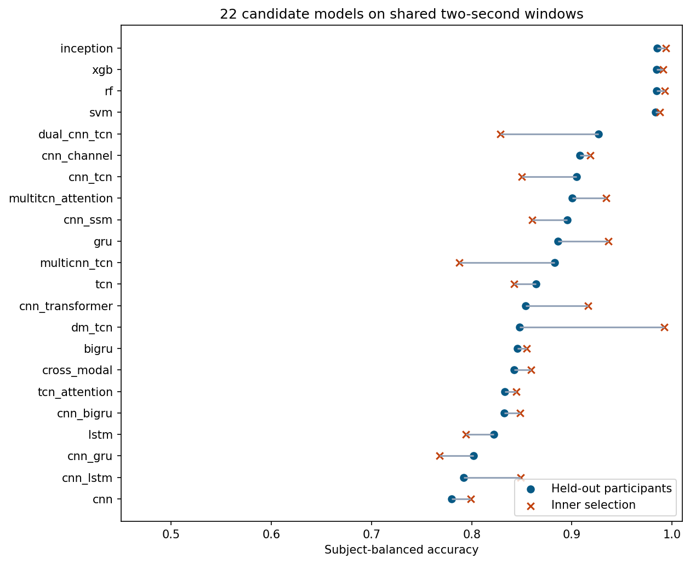
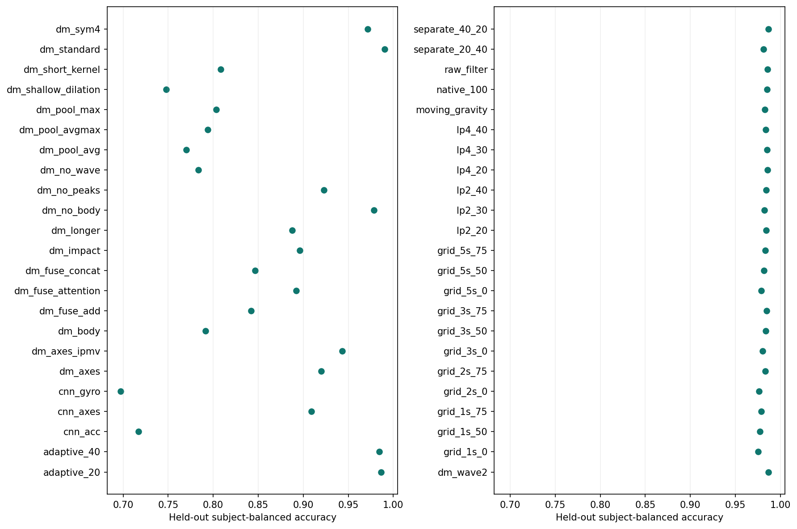
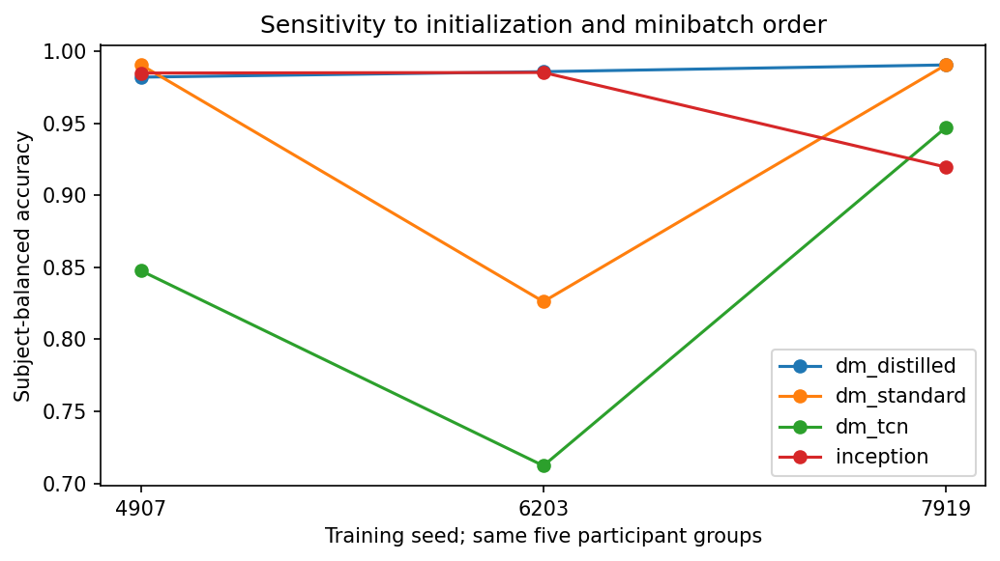

# SisFall fall detection on six waist IMU axes

**The prespecified selection rule chose 100 Hz IPMV + XGBoost for the edge prototype.** Its 8,195-byte model detected 1,776 of 1,798 simulated fall trials and correctly rejected 2,653 of 2,702 ADLs. Fixed-model subject-balanced accuracy was **98.51%**, fall F1 **98.04%**. It produced **52 false alerts over 14.50 hours of scripted ADLs**, or **3.59 per recorded hour**. That alarm burden warrants prospective testing before use as an unattended alert.

**The deep-learning candidate for further validation is a standard-scaled, dual-stream multiscale TCN trained with weak XGBoost witness scores.** The deployed network uses 5,846 parameters and executes independently of the training teacher. It obtained **98.20%, 98.58% and 99.04%** subject-balanced accuracy across three seeds. The same network trained with trial loss alone ranged from **82.62% to 99.04%** with standard scaling. The distilled experiment was motivated by observing this instability. Its three runs reuse the same participants and require confirmation on a new cohort.

## Study population and labels

We read 4,505 native trial files and retained 4,500 from 38 participants, comprising 2,702 ADLs and 1,798 simulated falls. Five D17 files under SA15 carried SE15 filenames. Distinct files with those names also appeared under SE15. Excluding the conflicts preserved a defensible subject split. Seventeen files had harmless trailing whitespace. The retained 15,833,929 rows cover 21.99 hours at nominal 200 Hz. ADL duration was 9.995–180 s (median 12), and fall duration was 14.455–15.030 s (median 15). We flagged 522 identical consecutive six-axis readings, 13 accelerometer rail samples and nine gyro rail samples. Identical rows may be valid readings. Sample indices cannot distinguish unmarked packet loss, repeated timestamps or true pauses. No peak was automatically discarded. [Dataset audit](dataset_audit.json) · [Counts and durations per activity](activity_audit.csv) · [Original publication](https://www.mdpi.com/1424-8220/17/1/198)

A depth-three tree trained solely on recording duration achieved **100% out-of-fold accuracy**. In total, 1,797 fall trials and zero ADLs rounded to 15 s. Even participant grouping permits a protocol cue shared by every participant. Waveform models receive fixed-length, unpadded windows from six channels only. Training uses eight acquisition-order positions per trial. We separately evaluate eight fixed positions versus scanning all available windows. Scripted movement and the presence of pre/post movement remain possible cues. [Duration control and fixed-exposure results](selection.json)

## Signal representation and weak supervision

1. Convert columns 1–3 to g using 32/8192 and columns 4–6 to degrees/s using 4000/65536 from the release readme. Retain source hash, subject, activity, trial, duration and nominal rate outside model inputs. The extra MMA8451Q and magnetometer supply zero model channels.
2. Keep a direct path from native acceleration and gyro magnitudes to 50 ms minima/maxima, means and magnitude-change evidence. The impact descriptor uses the maximum absolute one-sample derivative within a token. The parallel causal filter uses separate acceleration and gyro Butterworth sections. In its adaptive form, more of the raw residual passes as its norm grows. Fixed and adaptive orders/cutoffs are independently measured in the filter audit.
3. Estimate gravity per axis using a 0.75 Hz second-order filter with initial steady state. Subtract the estimated gravity vector to get dynamic acceleration, then project dynamic acceleration and gyro onto and perpendicular to gravity. Retain magnitude, tilt change and energy of those components. Rapid body rotation delays gravity estimates. A common constant orthogonal rotation preserves magnitudes and scalar projections. Axis/SMA controls retain coordinate-specific information.
4. Compute causal, three-level decimated db2 decomposition of native magnitude streams, align coefficients only after arrival, and retain per-token band RMS. Compare Symlet-4, fewer detail bands, gravity moving averages and wavelet-free alternatives. The default neural representation has 24 values per token. Raw oriented axes and axis-based SMA are optional controls. Final training pipelines use causal transforms. Zero-phase filtering appears only in the peak-retention analysis.
5. The primary models receive 40 tokens per two-second window, one new window each second. Neural scalers fit training subjects only, followed by invertible asinh compression. For deep training, backpropagate a single weighted binary loss on the maximum window logit of each recording. At evaluation, scan every available complete window and retain the recording maximum. The algorithm generates no impact timestamps.
6. Classical models use per-channel mean, deviation, min/max, RMS, range and half-window contrast. Train an initial positive witness at the highest acceleration among sampled windows and mine positives and hard ADL negatives again with the first classifier. Standardize aggregate descriptors on the training fold. For the selected XGBoost, 60 trees of depth three operate on 168 descriptors.
7. DM-TCN splits accelerometer and gyro features, projects each into 12 channels, applies parallel causal kernels 3/5/9 and residual temporal blocks with dilations 1/2/4. A learned sigmoid gate fuses branch features at each token. Attention pools across the completed window, then a linear head produces a logit. The temporal weights are model salience estimates. In the follow-up, a weak XGBoost teacher fitted to the same training participants supplies soft window targets (temperature 2) alongside the original trial loss. The teacher sees neither validation nor outer-test subjects during its respective fit.

The proposed novelty is the combination of native-transient preservation, gravity-relative sensor views, causal multiresolution features and weak supervision validated against duration, coordinate rotation and alert exposure. The teacher experiment tests a specific way to stabilize localization under trial-only labels. Wavelets, TCNs, attention and distillation themselves have established precedents. Priority over all published methods and accuracy on other devices remain open. [Literature and gap analysis](../../sisfall_literature.md) · [Protocol and selection rule](../../sisfall_protocol.md)

## Subject-independent model comparison

Five outer groups contained 8, 8, 8, 8 and 6 participants, with 946, 942, 946, 947 and 719 trials respectively. For each outer fold one other group set the threshold, calibration and training epoch, and the three remaining groups trained the inner model. The outer prediction used a refit on all four development groups. Balanced accuracy below equally weights mean participant fall sensitivity and mean participant ADL specificity. Only people contributing the relevant class enter that class mean. Recall, specificity and F1 in the table use pooled recording counts. A false alert is a new threshold excursion after a five-second refractory period and two below-threshold windows to re-arm.

| Primary model, same 200 Hz input and 2 s context | Inner BA % | Held-out subject BA % | Recall % | Specificity % | F1 % | False alerts/h |
|---|---:|---:|---:|---:|---:|---:|
| Compact InceptionTime | 99.40 | 98.48 | 98.22 | 98.70 | 98.14 | 2.41 |
| XGBoost | 99.12 | 98.46 | 98.72 | 98.11 | 97.96 | 3.79 |
| Random forest | 99.28 | 98.44 | 98.50 | 98.33 | 98.01 | 3.52 |
| RBF-SVM | 98.77 | 98.35 | 98.28 | 98.33 | 97.89 | 3.93 |
| Dual CNN–TCN + attention | 82.84 | 92.68 | 86.15 | 99.15 | 91.93 | 1.93 |
| CNN + channel attention | 91.81 | 90.80 | 85.15 | 96.37 | 89.35 | 8.00 |
| CNN + TCN | 84.99 | 90.48 | 83.54 | 97.41 | 89.14 | 5.86 |
| Multiscale TCN + attention | 93.39 | 90.00 | 89.10 | 91.08 | 88.00 | 21.59 |
| CNN + selective state-space block | 86.01 | 89.52 | 79.59 | 99.41 | 88.20 | 1.31 |
| GRU | 93.65 | 88.63 | 90.04 | 87.27 | 86.09 | 31.31 |
| Multiscale CNN + TCN | 78.77 | 88.27 | 87.76 | 88.49 | 85.60 | 26.00 |
| TCN | 84.25 | 86.42 | 78.42 | 94.26 | 83.85 | 13.03 |
| CNN + Transformer | 91.60 | 85.40 | 80.81 | 89.12 | 81.97 | 28.76 |
| DM-TCN, robust scaling | 99.20 | 84.75 | 76.64 | 92.45 | 81.54 | 20.07 |
| BiGRU | 85.48 | 84.57 | 78.48 | 90.90 | 81.68 | 20.97 |
| CNN + cross-modal attention | 85.90 | 84.24 | 73.69 | 95.11 | 81.41 | 10.41 |
| TCN + temporal attention | 84.43 | 83.28 | 68.24 | 98.41 | 79.99 | 3.17 |
| CNN + BiGRU | 84.84 | 83.27 | 73.30 | 93.34 | 79.98 | 13.72 |
| LSTM | 79.42 | 82.18 | 72.64 | 91.97 | 78.65 | 18.97 |
| CNN + GRU | 76.77 | 80.19 | 62.29 | 97.96 | 75.34 | 4.07 |
| CNN + LSTM | 84.91 | 79.18 | 59.68 | 98.52 | 73.72 | 2.90 |
| 1D CNN | 79.91 | 77.97 | 62.01 | 93.93 | 72.47 | 14.28 |

All 22 models used the same participant folds and representation. The neural screen used up to five epochs, class-weighted AdamW updates and identical initialization seeds across corresponding folds. The twelve-epoch DM-TCN control tested budget sensitivity. The Mamba-style comparator uses an input-conditioned diagonal state-space scan implemented in PyTorch. The InceptionTime comparator uses one compact six-module member. These comparisons characterize the implemented variants and budget. [Full scores, including ROC-AUC, AP and Brier](comparison.csv) · [Individual fold scores and sizes](fold_metrics.csv)

Model selection maximized inner participant-balanced accuracy under a 95% participant-specificity constraint. Within half a percentage point of the best validation score we preferred the smaller checkpoint. When repeated **inside each outer fold**, the all-candidate selection policy scored **98.05%** (participant bootstrap 95% interval **97.23–98.76%**), with 52 false-positive and 37 false-negative recordings. Its five choices differed. When restricted to the 22 primary or 19 neural candidates, both policies chose the same fold winners and scored **92.76%** (88.04–96.65%). Applying the rule to mean inner scores picked 100 Hz XGBoost overall, 200 Hz XGBoost on the primary menu and robust-scaled DM-TCN on the neural menu. Compact InceptionTime had the highest primary mean inner score and highest primary held-out BA. The tie rule favored size, which proved costly for the restricted neural choice. [Exact fold choices](outer_choices.csv) · [Selection estimates](selection.json)

## Ablations, failures and repeatability

| Question | Measured result |
|---|---|
| Window duration and overlap | Matched XGBoost subject BA spanned 97.55–97.90% for 1 s, 97.61–98.46% for 2 s, 98.04–98.49% for 3 s and 97.91–98.33% for 5 s. Among these twelve configurations, 3 s/50% had the highest mean inner score. The complete selector favored the smaller 100 Hz model. |
| Filtering and impact | On fall trials, a fixed order-two filter preserved median acceleration peak ratios of 0.929, 0.967 and 0.983 at 20, 30 and 40 Hz. The adaptive order-two ratios were 0.966, 0.975 and 0.982. For gyro the fixed 30 Hz path retained 0.988 versus 0.979 adaptive. The native peak channel bypasses both filters at the acquisition rate. XGBoost scored 98.59% with raw filtering and 98.46% on the default 200 Hz adaptive path. |
| Gravity and frequency content | Moving-average gravity yielded 98.26% on XGBoost. On robust-scaled DM-TCN, no wavelets gave 78.35%, Symlet-4 97.17% and keeping only the first two db2 detail bands 98.69%. The truncated variant drops the third detail and final low band together. These are representation changes under one seed. |
| Sensors, fusion and attention | On the CNN, acc-only and gyro-only yielded 71.70% and 69.70%; the combined IPMV view yielded 77.97%. The axes-only CNN reached 90.93%. On DM-TCN, addition, concatenation, two-weight modality attention and featurewise gating reached 84.20%, 84.65%, 89.22% and 84.75%. Temporal attention exceeded global average (77.02%), max (80.34%) and average+max (79.38%) in that matched model. |
| Scalar normalization and budget | DM-TCN with standard scaling reached 99.04%, robust scaling 84.75%, and a twelve-epoch robust fit 88.79%. One robust-scaled refit on outer group 3 classified every fall as ADL at its inherited threshold (AUROC 0.878). Both rank discrimination and threshold transfer merit examination. |
| Equal exposure | Eight equally spaced scored windows gave 98.43% versus 98.51% with exhaustive scanning for the chosen XGBoost. Standard DM-TCN gave 98.82% versus 99.04%; InceptionTime gave 96.49% versus 98.48%. A long ADL has many more opportunities to trigger an alarm in exhaustive replay. |

After reviewing the initial neural results, we repeated training with two additional seeds and tested the teacher-assisted DM-TCN. The same participants, splits and tuning rules were used across repeats. Means below describe three training runs on one cohort. Initial run 4907 was fixed for export, and all three results are retained.

| Neural configuration | Seed 4907 BA % | Seed 6203 BA % | Seed 7919 BA % | Mean BA % | False alerts/h by seed |
|---|---:|---:|---:|---:|---|
| dm_tcn | 84.75 | 71.23 | 94.69 | 83.56 | 20.07 / 11.72 / 4.69 |
| dm_standard | 99.04 | 82.62 | 99.04 | 93.56 | 1.03 / 14.14 / 2.07 |
| inception | 98.48 | 98.52 | 91.96 | 96.32 | 2.41 / 3.79 / 5.52 |
| dm_distilled | 98.20 | 98.58 | 99.04 | 98.61 | 2.21 / 2.34 / 3.10 |

Paired participant bootstraps for distillation minus standard-scaled DM-TCN gave −0.84 percentage points (95% interval −1.59 to −0.20), +15.96 (+8.04 to +24.91), and approximately 0.00 (−0.40 to +0.49). The principal observed benefit was avoiding the poor middle-seed fit. The sign varied across seeds. [Seed results](replicate_seeds.csv) · [Paired intervals](distillation_paired.csv)

## Errors, transfer and deployment

The fixed 100 Hz model missed 22 falls and misclassified 49 ADL recordings. Forward falls while sitting down (F10) accounted for six misses, and forward falls while sitting (F13) for five. Turning from supine to lateral and back (D14) caused 14 false-positive recordings, rapid lying/sitting (D13) ten, and stumbling (D18) seven. Fifty-two distinct alarms occurred in the 49 false-positive trials. The rate is **4.02/h** over the 12.93 hours between the first and last valid window endpoints, or **3.59/h** over all 14.50 recorded ADL hours. Scripted ADL prevalence differs from daily life. Pooled fall precision of 97.32% uses this dataset's 39.96% fall-trial prevalence.

Among older participants the model correctly rejected 883 of 893 ADLs. It detected 71 of 75 simulated falls from SE06. The remaining 14 older participants contributed only ADLs. A precise estimate of elderly fall sensitivity, onset latency and real-life alert precision requires new data.

All four initially profiled invariant configurations reproduced their reference classifications under a shared, fixed random rotation per trial. The 100 Hz XGBoost scored 98.19% under simulated ±5% per-axis gain, fixed biases, additive noise and quantization, and 98.50% under substituting the ITG3200 vendor gyro gain. The gyro-gain substitution changed eight decisions. Running the 200 Hz standard-scaled DM-TCN at simulated 100 Hz gave 98.43%; this deliberate mismatch changed 48 decisions. Physical strap movement, dynamic misalignment and realistic transfer remain unmeasured. [Primary transfer tests](transfer.csv) · [Neural comparator tests](transfer_secondary.csv)

For the distilled neural candidate, shared static rotation changed zero decisions. Simulated gain/bias/noise gave 97.98% subject BA, the bandwidth/clipping challenge 97.84%, and a 100 Hz input to the 200 Hz fit 95.65%. Use its 200 Hz configuration for hardware validation. [Distilled-model stress tests](transfer_distilled.csv)

**Edge flow.** Waist MPU-9250 FIFO → physical units and device calibration → stateful IPMV → two-second trailing window every second → selected classifier → window evidence → local JSON alert after threshold/re-arm logic. An overflow or clock gap requires fresh window warm-up. The classification threshold and recording-level sigmoid coefficients ship with each model.

| Deployment bundle | Format and model bytes | Workstation p95 per complete one-second hop |
|---|---:|---:|
| 100 Hz XGBoost | NumPy ensemble, 8,195 | 1.36 ms |
| Teacher-trained DM-TCN | FP32 ONNX, 69,632 | 1.06 ms |
| Standard-scaled DM-TCN | FP32 ONNX, 69,632 | 1.34 ms |
| Compact InceptionTime | FP32 ONNX, 145,332 | 1.59 ms |

These timings cover preprocessing and scoring on the Windows workstation. Initial window accumulation, device I/O, networking and power are outside the timed section. The compact tree export differed from its training estimator by at most 1.44×10⁻⁶ logit on 256 probes, with zero threshold disagreements. The distilled network's FP32 export differed by at most 1.91×10⁻⁶, also with zero disagreements. For distilled DM-TCN, CUDA FP16 changed 3/4,500 held-out trial decisions and reduced the final ONNX file to 58,111 bytes. FP32 is the reference. Final all-subject weights use pooled out-of-fold threshold/calibration and have no new independent performance estimate. Actual Nano power, latency, sensor timing, accuracy and prolonged ADL burden require board and wearer measurements. [XGBoost export evidence](export_native_100.json) · [Distilled neural export](export_dm_distilled.json) · [FP16 sensitivity](precision_dm_distilled.json) · [Target commands and calibration](../../../modules/imu/docs/hardware_validation.md)

## Reproduction and outputs

The original comparison contains 340 fold runs. Two new seeds for three neural comparators add 30 and the three-seed distilled follow-up adds 15, for **385 experiment–fold evaluations**. The first 340 contain 306,000 held-out trial decisions across 68 configurations. The source audit rehashed all 4,500 included recordings. The streamed implementation was compared with whole-recording processing on ADL, younger-fall and older-fall inputs. Detailed predictions, window scores, excluded identities and checkpoints are stored locally. [Reproduction commands and locations](../../../modules/imu/README.md) · [Verification record](verification.json)

**Figures.** [Native signal traces](figures/native_signals.png) · [Per-axis gravity and dynamic acceleration](figures/gravity_components.png) · [Recording duration and impact distribution](figures/dataset_profile.png) · [Filter peak retention](figures/filter_peak_retention.png) · [Neural training and validation curves](figures/neural_training.png) · [Grouped confusion matrices](figures/confusion.png) · [ROC, precision–recall and reliability](figures/discrimination_calibration.png) · [Sensor transfer](figures/transfer.png).

